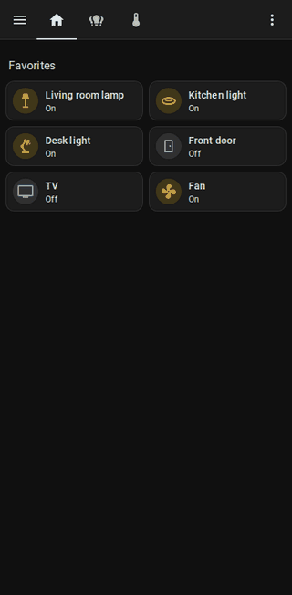

# Animated Swipe Navigation for Home Assistant

[](https://hacs.xyz/docs/faq/custom_repositories)
[](https://github.com/kyler-frazier/hass-animated-swipe-navigation/releases)
[](https://github.com/kyler-frazier/hass-animated-swipe-navigation/actions/workflows/tests.yml)
[](LICENSE)

Swipe between the views of a Home Assistant dashboard on your phone or tablet, with live
feedback while you drag: a liquid bubble is pulled out of the screen edge, shows the icon of the
view you're heading to, and snaps free with a little bounce once letting go will switch views.

<p align="center">
  
</p>

## Features

- **Live drag feedback.** The bubble grows out of the edge as you pull, stretches against the
  wall's surface tension, then pinches off and bounces when the swipe is far enough. Drag back
  and it re-merges with the wall. The current view follows your finger slightly.
- **Immediate, reliable navigation.** The view changes the moment you let go, so fast
  back-to-back swipes always count from the right view.
- **Plays well with scrolling.** Vertical scrolling is locked only while you're swiping
  sideways. Swipes that start on sliders, tabs, maps and similar controls are ignored.
- **Handles real fingers.** Direction changes mid-drag, second fingers, slow drags and fast
  flicks all behave predictably.
- **Respects your setup.** Follows your theme's primary color, supports right-to-left
  languages, and skips the animations when your device asks for reduced motion.
- **No build step, no dependencies.** A single small JavaScript file.

## Installation

### HACS (recommended)

1. In HACS, open the menu (⋮) → **Custom repositories**.
2. Add `https://github.com/kyler-frazier/hass-animated-swipe-navigation` with the type
   **Dashboard**.
3. Search for **Animated Swipe Navigation**, download it, and reload your browser or app.

### Manual

1. Download `animated-swipe-navigation.js` from the
   [latest release](https://github.com/kyler-frazier/hass-animated-swipe-navigation/releases/latest)
   into your `config/www/` folder.
2. Go to **Settings → Dashboards → ⋮ → Resources** and add `/local/animated-swipe-navigation.js`
   as a **JavaScript module**.

## Usage

Swiping is enabled per dashboard. Open the dashboard, choose **⋮ → Edit dashboard → ⋮ → Raw
configuration editor**, and add an `animated_swipe_nav` block at the top level:

```yaml
animated_swipe_nav: {}
views:
  # ...
```

Then swipe left for the next view and right for the previous one. Give your views icons: the
bubble shows the destination view's icon (or an arrow if it has none).

### Options

All options are optional.

| Option                | Default                    | Description                                                                       |
| --------------------- | -------------------------- | --------------------------------------------------------------------------------- |
| `enable`              | `true`                     | Turn swiping off without removing the block.                                      |
| `wrap`                | `true`                     | Swiping past the last view goes to the first, and vice versa.                     |
| `swipe_amount`        | `15`                       | How far a swipe has to travel to switch views, in % of the screen width.          |
| `skip_tabs`           | `[]`                       | View indexes (starting at 0) that swiping never lands on.                         |
| `skip_subviews`       | `true`                     | Skip subviews.                                                                    |
| `skip_hidden`         | `true`                     | Skip views hidden from the current user.                                          |
| `liquid`              | `true`                     | Show the "water" the bubble is pulled out of. `false` shows just the bubble.      |
| `haptics`             | `true`                     | Short vibration when the swipe will switch views (where supported, e.g. Android). |
| `bubble_color`        | `#34373e`                  | Bubble color while dragging.                                                      |
| `bubble_active_color` | darkened `--primary-color` | Bubble color once letting go will switch views. Any CSS color.                    |
| `icon_color`          | `#b4b7bf`                  | Icon color while dragging.                                                        |
| `icon_active_color`   | `rgba(255, 255, 255, .85)` | Icon color once letting go will switch views.                                     |

Example:

```yaml
animated_swipe_nav:
  wrap: false
  swipe_amount: 20
  skip_tabs: [3]
  bubble_active_color: var(--accent-color)
```

## Coming from hass-swipe-navigation

This plugin was inspired by [hass-swipe-navigation](https://github.com/zanna-37/hass-swipe-navigation),
which provides the same core navigation with more options (mouse swiping, custom animations,
an extensive list of custom cards to ignore). To switch:

1. Remove hass-swipe-navigation (or its resource), so the two don't both navigate.
2. Rename `swipe_nav:` to `animated_swipe_nav:` in your dashboards. `wrap`, `swipe_amount`,
   `skip_tabs`, `skip_subviews` and `skip_hidden` work the same way. Options that don't exist here
   (such as `animate` or `enable_mouse_swipe`) are ignored.

## Limitations

- Touch only: mouse and trackpad swiping isn't supported.
- Swipes starting on the most common horizontally-interactive controls are ignored. Some custom
  cards may need adding to the list. Please [open an issue](https://github.com/kyler-frazier/hass-animated-swipe-navigation/issues)
  if a card of yours conflicts.

## Contributing

Bug reports and pull requests are welcome. See [CONTRIBUTING.md](CONTRIBUTING.md) for how to run
the test suite against a throwaway Home Assistant instance.

## License

[MIT](LICENSE)
